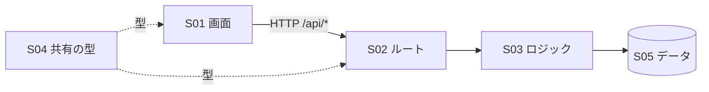
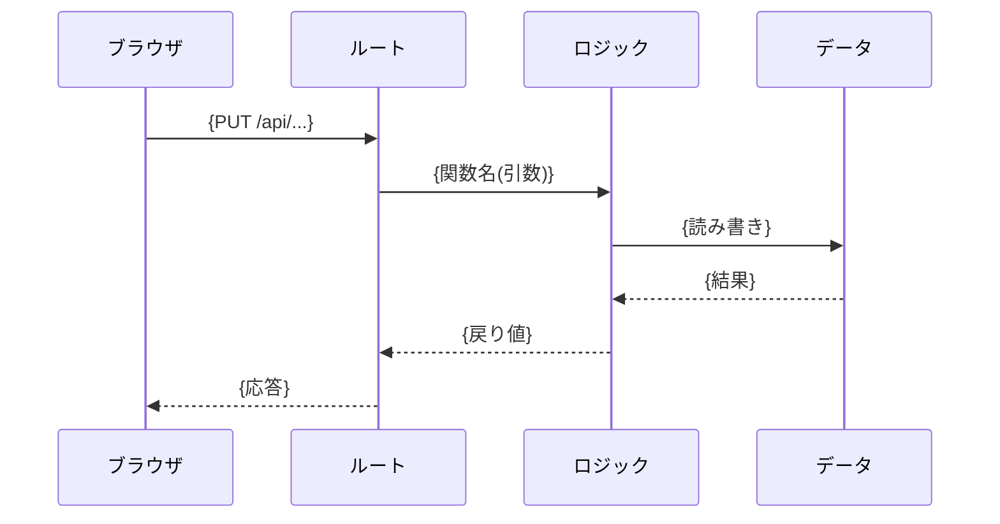
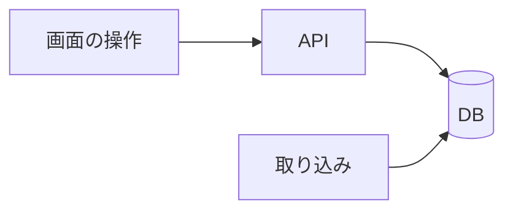

# {対象システム} 全体像

> **役割**: システムの「形」。層の構成、区画どうしの関係、主要な処理の流れ、エントリポイント。
> **検証リビジョン**: `{40桁の完全な commit SHA}`
> **最終更新**: {YYYY-MM-DD}

<!-- 図と根拠の書き方は references/diagrams-and-evidence.md に従う。
     図に描いてよいのは実コードで確かめたものだけ。根拠は図の中ではなく、直下の表に 1 つずつ書く。 -->

## アーキタイプ・層構成

- 🔵 {例: SPA＋REST API の Web アプリ。npm ワークスペースのモノレポ} `{./package.json:9-13}`
- 🔵 {例: 層は 画面 → 共有の型と通信 → ルート → ロジック → データアクセス} `{api/models/index.js:13}`

## 図A. 構成（区画の単位）

> 何がどこにあるか。ノードは区画（最大 12）。辺は「使う」向き。

| ノード | 根拠 |
|---|---|
| S01 → S02 | `{client/src/data-provider/mutations.ts:91-114}` |
| S02 → S03 | `{api/server/routes/index.js:40}` |
| S03 → S05 | `{api/models/index.js:13}` |

- **注記**: {循環依存・層の決まりに反する依存があれば書く。無ければ「なし」}

## 区画の要約

<!-- すべての区画を 1 行ずつ。深さが「浅い」の区画は、ここが唯一の記載になる。
     「未探索」の区画は役割を 🟡（目録からの推測）で書き、入口と依存は「未確認」とする。 -->

| ID | 役割 | 入口（外から呼ばれる面） | 使う区画 | 根拠 |
|---|---|---|---|---|
| S01 | 🔵 {役割} | {画面の起点・公開している関数など} | S04 | `{path:line}` |
| S02 | 🔵 {役割} | {ルートの登録} | S03 | `{path:line}` |
| S06 | 🟡 {目録からの推測} | 未確認 | 未確認 | — |

## 図B1. 主要フロー: {名前（例: 「おぼえた！」の保存）}

> 区画をまたぐ代表的な要求を、入口から出口まで。1〜2 本（図B2 は無くてもよい）。どれを選ぶかは下の「主要フローの選び方」の表で決める（references/diagrams-and-evidence.md の 2-1）。
> 見出しは「図B1. 主要フロー: 名前」の形を変えない（鮮度の確認スクリプトが流れとして見分ける）。見出しの直下に図、その直下に根拠の表を置く。

| 参加者・処理 | 根拠 |
|---|---|
| ルート | `{path:line-line}` |
| ロジック | `{path:line-line}` |

## 図B2. 主要フロー: {名前}

> 2 本目（あれば）。図B1 と同じ形で書く。無ければこの節を消す。

## 主要フローの選び方

<!-- 候補（利用者や外部が起こす要求）を並べ、4 つの観点で比べた結果。選んだ理由と、選ばなかった候補をどこで読めるかを残す。
     ③ 変更の頻度は、入口のファイルで `git log --oneline --follow -- <パス> | wc -l` を数えた値（数えた日も書く）。 -->

| 候補 | 入口 | ① 壊れたときの影響 | ② またぐ区画 | ③ 変更の頻度 | ④ 利用者にとっての中心 | 扱い |
|---|---|---|---|---|---|---|
| {例: 実力テストの採点と解放} | `{path:line}` | 高（次のページの解放はここだけ） | 3（S01・S02・S03） | 4 回 | 中 | 図B1 |
| {例: 「おぼえた！」の保存} | `{path:line}` | 中（1 行の保存） | 3 | 2 回 | 高 | 図B2 |
| {例: アカウントの削除} | `{path:line}` | 高 | 2 | 1 回 | 低 | 選ばない（S01 の「主な流れ」） |

- 選んだ理由: {1〜2 文。例: ① が高く区画を 3 つまたぐ採点と解放を 1 本目に、利用者の操作で最も多い保存を 2 本目にした}
- 変更の頻度を数えた日: {YYYY-MM-DD}

## 図C. データの流れ

> データがどこから来て、どこへ書かれるか。永続化や外部のデータ源があるなら描く。該当しなければこの節を消し、理由を一言残す。

| ノード | 根拠 |
|---|---|
| api | `{path:line}` |
| imp | `{path:line}` |

## エントリポイント

| 種類 | 場所 | 補足 |
|---|---|---|
| サーバーの起動 | `{path:line}` | {起動の関数・待ち受け} |
| ルートの登録 | `{path:line-line}` | {登録の方式} |
| 画面の起点 | `{path:line}` | {ルーターの定義} |
| ジョブ・CLI | `{path:line}` | {あれば} |

## 外部への依存

| 相手 | 用途 | 接続している場所 |
|---|---|---|
| {例: MongoDB} | {永続化} | `{path:line}` |
| {例: Redis} | {キャッシュ・キュー} | `{path:line}` |

## コマンド

<!-- マニフェストと規約文書から拾う。実行して確かめたものだけ 🔵。読んだだけなら 🟡。 -->

| 目的 | コマンド | 出どころ | 信頼性 |
|---|---|---|---|
| 依存の導入 | `{npm ci}` | `{./package.json:20}` | 🟡 |
| 起動 | `{npm run backend:dev}` | `{./package.json:45}` | 🟡 |
| テスト | `{npm run test:api}` | `{./package.json:60}` | 🟡 |
| Lint・型チェック | `{npm run lint}` | `{./package.json:70}` | 🟡 |

## 描かなかった図と理由

- {例: 図C は描いていない。永続化が 1 か所だけで、図B1 で足りるため}
- {例: 図B2 は描いていない。区画をまたぐ要求が 1 種類しかないため}
