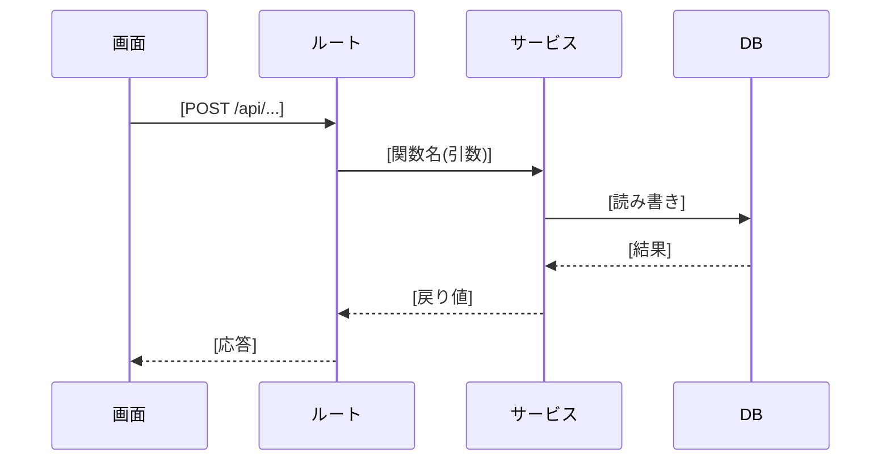

# 理解ブリーフ（Understanding Brief）出力テンプレート

このファイルは `power2-understand` スキルが `understanding-brief.md` を生成する際に参照する書式の定義です。後続の `power3-design` が拠り所にするため、以下を厳密に守ること。

**役割の分担**: 既存システムの地図（全体像・規約・用語・区画のページ）は `docs/code-atlas/` にある。このブリーフには、**この機能に固有のこと**（統合点・フロー・影響範囲・矛盾）だけを書く。地図帳に書いてあることは写さず、区画の ID（S03）や規約の ID（CV-05）で参照する。

**信頼性レベル**（全項目に付す）: 🔵 確実（実コードで確認済）／🟡 妥当な推測（要確認）／🔴 推測。
power1-scope の 🟡[C] 候補を実コードで検証して 🔵 に昇格させたものは、根拠（`file:line`）を必ず添える。

**根拠の書き方**: リポジトリのルートからの完全なパスで、1 つのバッククォートに 1 つだけ書く（`src/db/taskRepo.ts:45`）。ファイル名だけ・途中からのパス・`:45` だけ・`a.ts:1, 5` のような並べ書きは、検証されないか、検証で落ちる。基準は `code-atlas/references/diagrams-and-evidence.md`。

---

## 出力テンプレート

以下に従って `docs/spec/{機能名}/understanding-brief.md` を生成する。`[...]` は実際の内容で置き換える。

````markdown
# 理解ブリーフ（Understanding Brief）

**機能名:** [kebab-case-name]
**対象リポジトリ:** [repo 名]
**作成日:** YYYY-MM-DD
**入力:** docs/spec/[機能名]/feature-requirements.md
**プロジェクト種別:** [beam / 一般]
**ドキュメント信頼度:** [高（型/スキーマ/OpenAPI/テスト） / 中（手書きアーキ） / 低（散文/無）]

> **検証リビジョン**: `[40桁の完全な commit SHA]`

---

## 0. この機能が乗る区画

> 地図帳（[index.md](../../code-atlas/index.md)）の区画のうち、この機能が触るもの。実装のときに、どのページを読めばよいかの案内になる。
> 地図帳のページは**リンクで書く**（バッククォートで書かない）。地図帳はこのブリーフと同じコミットで初めて入ることが多く、検証リビジョンの時点ではまだ存在しないため、バッククォートで書くと根拠の検証で落ちる。

| 区画 | ページ | 深さ（読んだ範囲） | この機能との関係 |
|---|---|---|---|
| [S10 スキーマと DB メソッド] | [S10-data-schemas.md](../../code-atlas/sections/S10-data-schemas.md) | [深い（会話とタグの部分）] | [上限の判定を足す場所] |
| [S02 共有の UI 部品] | —（architecture.md） | [浅い] | [既存の部品を使うだけ] |

- **地図帳に無かったこと・食い違っていたこと**: [あれば。地図帳の側を直したなら、その旨]

---

## 1. 統合面（確定した統合点）

> 変更が接続・依存する既存コード。feature-requirements の INT を **実コードで検証・確定**したもの。

| ID | 接続先 | 場所 (file:line) | 契約・シグネチャ | 信頼性 |
|---|---|---|---|---|
| INT-01 | [既存モジュール/API/画面/データ] | `src/...:NN` | `[実シグネチャ]` | 🔵 |

**見本:**

| ID | 接続先 | 場所 (file:line) | 契約・シグネチャ | 信頼性 |
|---|---|---|---|---|
| INT-01 | タスク一覧コンポーネント | `src/web/taskList.tsx:120` | `<TaskList items={Task[]} />`。ボタンをツールバーに追加 | 🔵 |
| INT-02 | タスク取得関数 | `src/db/taskRepo.ts:45` | `listTasks(filter: Filter): Promise<Task[]>` を再利用 | 🔵 |

### この機能が乗るフロー

> この機能が乗る要求 1 本を、入口から出口まで。確かめた経路だけを描く（憶測は描かない）。該当しなければ、理由を一言書いて図を省く。



| 参加者・処理 | 根拠 | この機能で変わるか |
|---|---|---|
| [ルート] | `src/...:NN-NN` | [変わらない／ここに検証を足す] |
| [サービス] | `src/...:NN-NN` | [ここに上限の判定を足す] |

---

## 2. 踏襲すべき規約・パターン

> この機能の実装が合わせるべき既存の書き方。**全体の規約は [conventions.md](../../code-atlas/conventions.md) の ID で引用**し、この機能に固有のものだけを `file:line` で示す。

**見本:**
- CV-08（エラー処理: 固定の文言の 500 と `{ error }`）に従う。このルートは今 500 しか返さないので、上限の超過は 400 を足す。`src/server/routes/tags.js:118` 🔵
- CV-10（新しい上限は設定の項目として足す）に従う。🔵
- この機能に固有: メニューの項目は既存のフックが返す形に合わせる。`src/web/hooks/useItems.tsx:35` 🔵

---

## 3. データモデル・スキーマの現状

> 関係するテーブル・型の現状。変更が必要かは power3 設計で決定する（ここでは現状把握のみ）。

**見本:**
- `tasks` テーブル: `task_id INTEGER PK, title TEXT, status TEXT, ...`（`src/db/schema.sql:1`）。🔵
- この機能は読み取りのみで、スキーマ変更は不要の見込み。🟡（設計で最終判断）
- **既存データ**: [今回の要件と食い違うデータが既にあるか。例: 上限を超えた行があるか]

---

## 4. 影響範囲・回帰リスク（blast radius）

> 変更で影響しうる既存機能。feature-requirements の REG を **実コードで拡張・確定**。power6 の回帰検証の入力。

### 4-1. 同じデータを書き込む経路（すべて）

| # | 経路 | 場所 (file:line) | 今回の変更との関係 |
|---|---|---|---|
| 1 | [画面からの操作] | `src/...:NN` | [ここに上限を入れる] |
| 2 | [取り込み] | `src/...:NN` | [上限を通らない。入れるかどうかを設計で決める] |

### 4-2. 共用部品の利用元

| 部品・関数 | 使っている場所 (file:line) | 今回の変更との関係 |
|---|---|---|
| [共用のダイアログ] | `src/...:NN` | [管理画面でも使う。上限の制御を入れると巻き込む] |

### 4-3. 回帰リスク

| ID | 影響しうる既存機能 | 根拠 (file:line) | なぜ影響するか | 検証方法 | 信頼性 |
|---|---|---|---|---|---|
| REG-01 | [既存機能] | `src/...:NN` | [理由を一言] | [回帰の確認方法] | 🟡 |

**見本:**

| ID | 影響しうる既存機能 | 根拠 (file:line) | なぜ影響するか | 検証方法 | 信頼性 |
|---|---|---|---|---|---|
| REG-01 | 一覧の描画速度 | `src/web/taskList.tsx:120` | 行ごとに項目が増える | 1000件表示の速度が既存 NFR を維持するか実測 | 🟡 |
| REG-02 | フィルタ機能 | `src/web/filter.ts:20` | 同じ配列を読む | フィルタ後件数とエクスポート件数が一致するかテスト | 🔵 |

### 4-4. 隠れた結合

- [グローバル状態・副作用・順序依存・手で同期している派生値・同時実行。例: 件数の更新が本体の更新より先に走る `src/...:NN`] 🔵

---

## 5. リスク・未解決の論点

> 設計（power3）の前に解消すべき疑問。ユーザー確認が要るものは明記する。

- **既存要件との矛盾**: [無ければ「無し（確認した場所: …）」。有れば 🔴 で、該当 ID・内容・`/revise` の実施時期]
- **見つからなかったこと**: [「呼び出しが見つからない」は「影響が無い」ではない。確かめた方法と一緒に書く]

**見本:**
- 大量件数（1万件超）のエクスポートはスコープ外か要確認（feature-requirements では1000件想定）。🟡
- 既存に CSV 生成のユーティリティがあるか未確認（重複実装回避のため power3 で再探索）。🟡

---

## 6. 参照した地図帳

- [index.md](../../code-atlas/index.md)（このブリーフの作成時に、[新規に作成／区画 S10 を深掘り／更新]）
- 読んだページ: [[S10-data-schemas.md](../../code-atlas/sections/S10-data-schemas.md) ほか]
````
