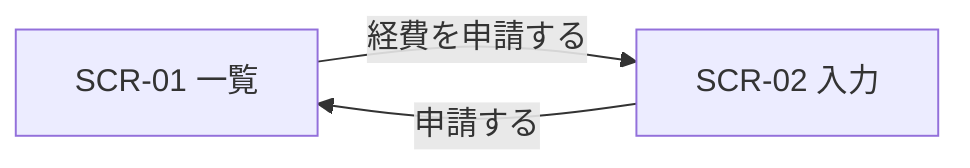

# 画面の設計 — {要件名 / 機能名}

> ui-design plan（{新規 / 追従 / 一新}）が作成。**この要件・機能の画面ごとの目的・導線と手数の予算・状態・文言**を決める。見た目の決まりは `docs/ui/standard.md`。
> 画面 ID（SCR-xx）と導線 ID（J-xx）は `docs/ui/screens.json` と同じ。各項目に信頼性（🔵 確実 / 🟡 妥当な推測 / 🔴 推測）と出典（US / REQ / FR / コード）を付ける。
> 実装の後、ui-design polish がこの文書を物差しにして画面を磨く。

## 1. 画面一覧

| 画面 ID | 名前 | 目的（この画面でする仕事） | 主役の操作 | 表示するデータ（API） | 予定の URL | 出典 | 信頼性 |
|---|---|---|---|---|---|---|---|
| SCR-01 | （例）経費の申請一覧 | 自分の申請の状況を確かめる | 経費を申請する | 申請の一覧（`GET /api/claims`） | `/claims` | US-001・REQ-003 | 🔵 |

- 1画面の表示に呼ぶ API は少なく保つ（beam3 では api-endpoints.md と突き合わせる）。

## 2. 導線と手数の予算

> 主要な US ごとに、画面の順と手数の予算を決める。目安は「主要な操作は3手以内」。手数は、押す・選ぶ・キーを押す操作を数える（入力は数えない）。

### J-01 （例）経費を申請する（US-001）— 予算 3 手

| 手 | 画面 | 操作 | 利用者に見える結果 |
|---|---|---|---|
| 1 | SCR-01 | 「経費を申請する」を押す | 入力画面が開く |
| — | SCR-02 | 件名・金額を入力する（手数に数えない） | — |
| 2 | SCR-02 | 「申請する」を押す | 一覧に戻り「申請しました」と出る |

## 3. 状態の見せ方

| 画面 ID | 読み込み中 | 0件 | エラー | 完了 | 権限なし |
|---|---|---|---|---|---|
| SCR-01 | 表の形の帯 | 「まだ申請がありません」＋主ボタン | 「読み込めませんでした。時間をおいて再読み込みしてください」 | 一時的な知らせ「申請しました」 | — |

## 4. 文言

| 言葉・ボタン名 | 使う場面 | 完了の知らせ | 出典 |
|---|---|---|---|
| 申請する | SCR-02 の主ボタン | 申請しました | US-001 |

- 新しい用語は `docs/ui/standard.md` の用語集にも足す（追従のとき）。

## 5. 既存の決まりとの関係（追従・一新のとき）

- 従う既存の部品・画面の型: {例: 一覧は `src/web/ListPage.tsx` の型に合わせる（`file:line`）}
- standard.md に足すこと: {新しい種類の画面・部品があれば}
- 今回は直さず backlog へ送る元からある問題: {あれば ID}

## 6. 未決事項

| 項目 | 選択肢 | 決める人・時期 |
|---|---|---|
